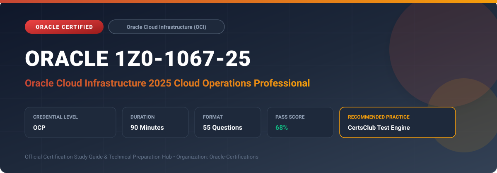

  

# Oracle 1Z0-1067-25: Oracle Cloud Infrastructure 2025 Cloud Operations Professional

[-red?style=for-the-badge)](https://education.oracle.com/)

---

## 1. Exam Overview & Candidate Profile

The **Oracle 1Z0-1067-25: Oracle Cloud Infrastructure 2025 Cloud Operations Professional** examination is designed for cloud professionals, enterprise architects, implementation consultants, and systems administrators who demonstrate deep practical knowledge and operational competence in deploying, configuring, and optimizing Oracle technologies.

The Oracle Cloud Infrastructure 2025 Cloud Operations Professional (1Z0-1067-25) certification validates hands-on sysops and DevOps skills in automating, monitoring, scaling, securing, and troubleshooting enterprise environments on OCI. Key areas include OCI CLI, Terraform / Resource Manager, Monitoring & Logging services, OS Management, cost governance, and business continuity.

### Target Audience & Prerequisites
- **Target Roles**: Implementation Consultants, Cloud Solution Architects, DevOps/SysOps Engineers, and Enterprise Functional Analysts.
- **Recommended Experience**: 1–2 years of hands-on experience in configuring, administering, or implementing the relevant Oracle solutions.
- **Credential Earned**: Oracle Certified Professional (OCP).

---

## 2. Key Exam Specifications

| Specification | Details |
| :--- | :--- |
| **Exam Code** | **Oracle 1Z0-1067-25** |
| **Official Title** | Oracle Cloud Infrastructure 2025 Cloud Operations Professional |
| **Certification Track** | Oracle Cloud Infrastructure (OCI) |
| **Exam Duration** | 90 Minutes |
| **Number of Questions** | 55 Questions |
| **Passing Score** | 68% |
| **Question Format** | Multiple Choice (Single/Multiple Answer), Scenario-Based Questions |
| **Delivery Provider** | Oracle University / Pearson VUE (Online Proctored or Test Center) |
| **Recommended Practice Engine** | [CertsClub Oracle Practice Tests](https://www.certsclub.com/oracle/1z0-1067-25-dumps.html) |

---

## 3. Official Blueprint & Exam Domain Breakdown

The examination assesses candidate competencies across core functional domains weighted as follows:

| Domain Area | Weighting |
| :--- | :--- |
| **Cloud Automation & Infrastructure as Code (Terraform)** | `25%` |
| **Monitoring, Observability, & Log Management** | `25%` |
| **Compute, Storage, & Networking Operations** | `20%` |
| **Security, IAM Policies, & Compliance** | `15%` |
| **Cost Governance, Budgets, & Disaster Recovery** | `15%` |

---

## 4. Deep Dive into Complex & Challenging Technical Topics

To secure a passing score on the 1Z0-1067-25 exam, candidates must master the following advanced concepts:

- Writing and troubleshooting HashiCorp Terraform modules deployed via OCI Resource Manager with state management.
- Configuring custom MQL (Monitoring Query Language) metric alarms, notification topics, and automated function triggers.
- Managing OS Management Hub for automated software vulnerability scanning and kernel patch rollouts.
- Designing cross-region automated backup policies for Block Volumes, Object Storage lifecycle rules, and DR drills.

---

## 5. Scenario-Based Demo & Practice Questions

### Question 1
A Cloud Operations engineer needs to configure automated scaling for an OCI compute instance pool based on real-time CPU utilization metrics. What OCI service should be configured?

A) OCI Autoscaling with metric-based policies
B) OCI Cloud Guard automated responder
C) OCI Security Zones
D) OCI Data Flow

- **Correct Answer**: `A) OCI Autoscaling with metric-based policies`
- **Technical Explanation**: OCI Autoscaling allows defining threshold rules (e.g., average CPU utilization > 75%) that automatically adjust the number of compute instances in an instance pool.

---

### Question 2
Which OCI monitoring feature allows administrators to query custom operational telemetry across cloud resources using a domain-specific mathematical expression language?

A) Cloud Shell Bash parser
B) Monitoring Query Language (MQL)
C) Logstash filter syntax
D) PromQL only

- **Correct Answer**: `B) Monitoring Query Language (MQL)`
- **Technical Explanation**: OCI Monitoring uses MQL (Monitoring Query Language) to define metric aggregation functions, group-by dimensions, intervals, and alarm conditions across tenancy resources.

---

## 6. Recommended Preparation Strategy & Practice Testing Engine

Achieving certification in **Oracle 1Z0-1067-25** requires balanced theoretical study and scenario-based simulation practice:

1. **Review Oracle Documentation**: Master architecture guides, implementation workbooks, and administration manuals on the Oracle Help Center.
2. **Hands-on Lab Practice**: Execute real-world configuration, policy setup, and troubleshooting tasks in your cloud tenancy or test instance.
3. **Simulated Exam Drills**: Practice answering timed, scenario-based multiple-choice questions to familiarize yourself with the question formats, traps, and timing constraints.

### Practice With CertsClub
For realistic practice questions, updated dumps, and mock testing environments:
- **Resource**: [CertsClub Oracle Practice Test Engine](https://www.certsclub.com/oracle/1z0-1067-25-dumps.html)
- **Special Discount**: Use coupon code **`club20`** during checkout for an instant **20% discount** on all practice exam bundles and testing engines.

---

## 7. Official Documentation & References

- [Oracle University Certification Registry](https://education.oracle.com/)
- [Oracle Help Center Documentation Portal](https://docs.oracle.com/)
- [Oracle Cloud Infrastructure & Applications Guides](https://docs.oracle.com/en/cloud/)
- [CertsClub Oracle Certification Exam Practice](https://www.certsclub.com/oracle/1z0-1067-25-dumps.html)

---

## 8. SEO & Discovery Keywords

`oracle 1z0-1067-25`, `oracle 1z0-1067-25 exam`, `oracle 1z0-1067-25 dumps`, `1Z0-1067-25 practice questions`, `1Z0-1067-25 study guide`, `oracle 1z0-1067-25 syllabus`, `oracle cloud infrastructure 2025 cloud operations professional`, `certsclub 1z0-1067-25`